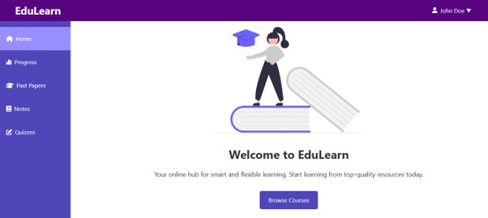
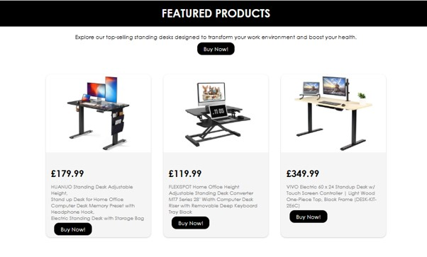

# Hi there, I'm Bongani! 👋

## About Me 🚀

I'm a passionate **developer** with experience in **HTML, CSS, JavaScript, Python, C#, and MySQL**. I love tackling complex problems, learning new skills, and collaborating with diverse teams to create innovative solutions.

- 🌱 Currently learning: **Vue.js, Django, React**
- 🔭 Working on: **Personal Portfolio Website, Blog Website**
- 🌍 Languages: **I speak English**
- 📫 How to reach me: **My email is bonganincube893@gmail.com**
- ⚡ Fun fact: **Grew up wanting to create video games for a living**

## My Skills 🧠

<!--*Replace the above skill badges with your own skills and expertise. To create more badges, use [checkout this repo](https://github.com/alexandresanlim/Badges4-README.md-Profile).*-->

## Featured Projects 💻

### [EduLearn - A Zambian Secondary School E-learning Website](https://edulearn123.wuaze.com/)

**EduLearn** is an **e-learning website aimed at secondary school students in Zambia under the ECZ curriculum, which will enable them to access educational resources such as notes based on subjects, past exam papers, and interactive quizzes** and it is built with **HTML, CSS, JavaScript, PHP, and MySQL**. This project demonstrates my ability to **analyse a project area, identify a relevant problem, build and deploy a solution, as well as project management and documentation**. You can check out the repository [here](https://github.com/bongani-nc/edulearn).

### [Standing Desk Website](https://bongani-nc.github.io/standing-desks/home.html)

**The Standing Desk Website** is a **a standing desk website that has various features such as a home page, benefits, cart, shopping page and a responsive design** built with **HTML, CSS, and JavaScript**. This project showcases my skills in **designing and developing a front-end website**. You can check out the repository [here](https://github.com/bongani-nc/standing-desks).

## Get in Touch 📬

- **[Personal Website / Blog]**(your_website_or_blog_link)
- **[LinkedIn]**(your_linkedin_profile_link)

